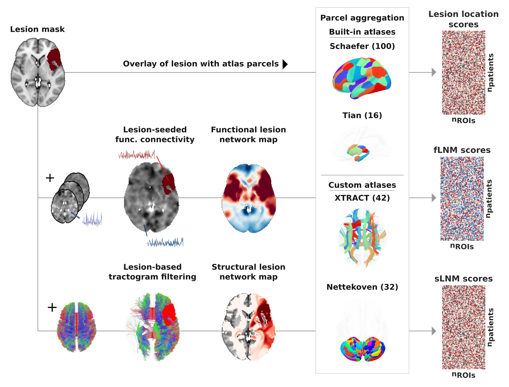

<p align="center">
  
</p>

<h1 align="center">Lacuna</h1>

[](https://www.python.org)
[](https://opensource.org/licenses/MIT)
[](https://lacuna-py.readthedocs.io/en/latest/)
[](https://github.com/m-petersen/lacuna)
[](https://doi.org/10.5281/zenodo.20668457)

> **Note**
> Lacuna is in alpha release and under active development. Interfaces may change between versions.

Lacuna characterizes brain lesions (stroke, tumor, or other focal injury) in the context of normative brain organization. Using reference data from healthy individuals, including functional and structural connectomes and anatomical atlases, it derives measures that go beyond a lesion's anatomical location.

You provide lesion masks in MNI space; Lacuna fetches the reference data, aligns coordinate spaces, and runs the analyses from a command line interface.

- **BIDS in, BIDS out:** standardized inputs and BIDS-organized outputs
- **Scales:** from a single mask to entire cohorts with batch processing
- **HPC-ready:** Docker and Apptainer containers
- **Traceable:** provenance recorded for every result

<p align="center">
  
</p>

## Analyses

| Analysis | Question |
|---|---|
| **Focal damage** | How much does the lesion overlap each region of a brain atlas? |
| **Functional lesion network mapping** | Which functional circuit is connected to the lesion? |
| **Accelerated functional network mapping** | The same, via a fast matrix-based method |
| **Structural lesion network mapping** | Which white-matter connections does the lesion disrupt? |

Requirements for each analysis (connectomes, MRtrix3, disk space) are described in the [documentation](https://lacuna-py.readthedocs.io).

## Install

```bash
pip install git+https://github.com/m-petersen/lacuna
```

Requires Python ≥ 3.10 on Linux (macOS untested; on Windows use WSL). Alternatively, use the container image, which includes MRtrix3:

```bash
docker pull ghcr.io/m-petersen/lacuna:edge
apptainer pull lacuna.sif docker://ghcr.io/m-petersen/lacuna:edge
```

## Quickstart

```bash
lacuna tutorial my_dataset                              # synthetic lesion masks
lacuna fetch hcp1065 --output-dir connectomes           # ~1.5 GB tractogram
lacuna run snm my_dataset output \
    --connectome-path connectomes/hcp1065.tck \
    --mask-space MNI152NLin6Asym
```

Results are written to `output/` as BIDS derivatives. Lesion masks must be in MNI space; see the [spatial normalization guide](https://lacuna-py.readthedocs.io/en/latest/how-to/01-spatial-normalization/).

## Documentation

Tutorials, how-to guides, and reference: **[lacuna-py.readthedocs.io](https://lacuna-py.readthedocs.io)**

## Citation

If you use Lacuna in your research, please cite it via its Zenodo DOI: [10.5281/zenodo.20668457](https://doi.org/10.5281/zenodo.20668457).

Lacuna builds on normative reference data (connectomes, atlases) produced by other groups. Please also cite the original publications for the datasets you use: `lacuna info licenses` lists bundled and downloaded datasets together with their license and citation.

## Contributing

Bug reports, feature requests, and pull requests are welcome via the [issue tracker](https://github.com/m-petersen/lacuna/issues).

## Acknowledgements

Lacuna is developed as part of the [Meta VCI Map Consortium](https://metavcimap.org/) and follows the [FAIR-BioRS guidelines](https://fair-biors.org/docs/guidelines). It is funded by [ZonMw](https://www.zonmw.nl/) and the [Deutsche Forschungsgemeinschaft (DFG)](https://www.dfg.de/).

## License

Code: MIT, see [LICENSE](LICENSE). Reference datasets carry their own licenses, some restricted to non-commercial use; run `lacuna info licenses` for details.
